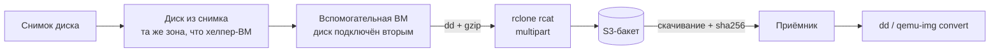

# Облачная виртуализация

## Основы

### Чем облачная виртуализация отличается от «своего» гипервизора

| Аспект | Облако (AWS-подобное) | Локальный гипервизор |
|---|---|---|
| Управление | API / CLI / Terraform, консоль вторична | CLI/GUI гипервизора |
| Ресурсы | инстанс, диск, снимок, образ — отдельные сущности с ID | файлы образов на хранилище |
| Зональность | диск должен находиться в зоне доступности ВМ | своё хранилище |
| Устройства | virtio-blk/virtio-net, имена `vda`/`vdb`, SERIAL = ID диска | sata/scsi, произвольные имена |
| Первичная настройка | cloud-init + сервис метаданных (SSH-ключи, hostname, сеть) | шаблоны, ручная настройка |
| Образы | «cloud images» с GPT + ESP + bios_grub | свои шаблоны |
| Обмен данными | объектное хранилище (S3 API) | NFS/SMB/шары |
| Доступ | IAM: роли, сервисные аккаунты, статические ключи | локальные учётные записи |
| Экономика | тарифицируются хранение, операции и трафик | свои ресурсы |

### Ресурсы: образ → снимок → диск

| Ресурс | Что это | Роль в переносе |
|---|---|---|
| **Образ** | Шаблон для создания дисков (обычно read-only) | Передаётся между облаками файлом: `qcow2`/`raw`/`vmdk`/`vhd` |
| **Снимок** | Полная копия диска на момент времени, хранится в облаке | Источник данных: из снимка разворачивается диск |
| **Диск** | Блочное устройство, подключается к ВМ | Подключается к вспомогательной ВМ вторым и читается целиком |

**Важно:** снимок с работающей ВМ почти всегда «грязный» — файловая система не размонтирована, транзакции остаются в журнале. Образ при этом валиден: журнал воспроизведётся при первой загрузке у приёмника. Как проверить состояние ФС — документ [fs](../Linux/fs.md).
<!-- more -->
### Cloud-образы и разметка диска

- Облачные образы (Ubuntu, Debian и др.) размечены GPT: корневой раздел + заглушка `bios_grub` (~4 МиБ) + ESP (vfat, LABEL `UEFI`). Такой диск грузится и в BIOS, и в UEFI.
- **Важно:** диск с такой разметкой **самодостаточен как загрузочный**. Подключённый к инстансу «вторым» он может быть выбран как загрузочный, даже если в API загрузочным назначен другой диск — реальный пример разобран в шаге 1 кейса ниже. Практический обход: подключать целевой диск уже к запущенной ВМ и проверять `lsblk` сразу после подключения.
- **Важно:** ext4-разделы cloud-образов обычно имеют `Maximum mount count: -1` и `Check interval: 0` — автоматический `fsck` при загрузке не сработает, «грязный» журнал просто воспроизведётся ядром.

### Форматы образов дисков

| Формат | Кто понимает | Комментарий |
|---|---|---|
| `qcow2` | KVM/libvirt, Proxmox, OpenStack, облака | Оптимальный выбор: сжатие + разряжённость (пустые блоки места не занимают) |
| `raw` (+ `gzip`) | Все: `gunzip \| dd`, любой гипервизор | Максимальная совместимость, но сжатие «снаружи» файла |
| `vmdk` | VMware / ESXi | Конвертируется из `raw`/`qcow2` одной командой |
| `vhdx` | Hyper-V | То же |
| `vdi` | VirtualBox | То же |

Конвертация в формат приёмника делается локально после скачивания:

```bash
gunzip -c server-image.img.gz > server-image.img
qemu-img convert -f raw -O qcow2 server-image.img server-image.qcow2   # vmdk / vhdx / vdi — по вкусу
```

**Ограничение:** `qemu-img` требует seekable-выход — писать образ «на лету» в конвейер или в `/dev/stdout` нельзя. Для потоковой сборки `qcow2` в QEMU есть отдельный скрипт `qcow2-to-stdout.py`.

### Почему образ не отдают наружу напрямую

У облаков обычно есть **импорт** образа из объектного хранилища, но нет **экспорта** в него: API, который вернул бы файл образа, отсутствует. Отсюда типовая схема — развернуть снимок в диск, подключить его к вспомогательной ВМ и снять побайтовую копию в бакет. Часть провайдеров даёт обёртку над этим шагом: например, в Yandex Cloud есть пример `yc-disk-export-tool`, который сам создаёт диск из снимка, поднимает helper-ВМ, снимает образ через `qemu-img`, кладёт его в Object Storage и удаляет ВМ.

### Типовая схема выгрузки



### Объектное хранилище как транспорт

S3 API понимают `aws` (AWS CLI), `rclone`, `s3cmd`, SDK и большинство бэкап-утилит. Это обычный сервис облака: есть классы хранения (стандартный / холодный), тарифицируются хранение, операции и трафик.

| Лимит S3 | Значение |
|---|---|
| Одиночный `PUT` (объект за один запрос) | ≤ 5 ГБ |
| Минимальный размер части multipart, кроме последней | ≥ 5 МБ |
| Максимальное количество частей | 10 000 |
| Максимальный размер объекта | 5 ТБ |

Для диска 50+ ГБ ничего настраивать не нужно: загрузка идёт частями автоматически (у `rclone` размер части задаёт `--s3-chunk-size`, по умолчанию 5 МиБ — разумно поднять до 64 МиБ). Лимит касается консольного веб-интерфейса: крупные файлы через него не загрузить вообще.

Дополнительно: подписанные (presigned) ссылки позволяют отдать объект или залить его без ключей — этим пользуются при импорте образа в другое облако; брошенные multipart-загрузки занимают место и тарифицируются, поэтому полезны `rclone cleanup` и правило жизненного цикла «прервать незавершённые составные загрузки».

**Важно:** сводные счётчики объектов и объёма в веб-консоли обновляются с задержкой в несколько минут — судить о результате нужно по списку объектов или через CLI, а не по цифрам в списке бакетов.

**Важно:** образ диска **нельзя** писать через FUSE-монтирование бакета (`s3fs`, `goofys`, `geesefs`): такие ФС буферизуют запись в локальную директорию (`/tmp` у `s3fs`), а при ошибке выгрузки `s3fs` инвалидирует кеш — результат теряется молча. Нужен поток утилитой, которая сама делает multipart (`rclone`, `aws s3`).

## Кейс: выгрузка диска ВМ в S3-совместимое хранилище

### 1. Проверить, с какого диска загрузилась ВМ

```bash
lsblk -o NAME,SIZE,TYPE,FSTYPE,MOUNTPOINTS,MODEL,SERIAL
findmnt -no SOURCE /                # на каком диске корень
findmnt -no SOURCE /boot/efi        # и EFI-раздел
cat /proc/cmdline                   # root=UUID=…
```

Реальный случай: в API загрузочным указан диск 20 ГБ, но ВМ загрузилась с целевого диска 52 ГБ:

```text
vda       20G disk  SERIAL=bg025…
├─vda1   9.4G part ext4              ← «загрузочный» по API, не используется
└─vda15 600M part vfat
vdb       52G disk  SERIAL=bg0j1…
├─vdb1  51.4G part ext4   /          ← система загрузилась с ЦЕЛЕВОГО диска
└─vdb15 600M part vfat   /boot/efi
```

**Важно:** в этом состоянии целевой диск смонтирован rw и меняется на ходу — снятая копия будет несогласованной, а «спасаемая» система работает внутри вспомогательной ВМ. Лечение: пересоздать/перезапустить ВМ так, чтобы она грузилась со своего диска (надёжнее всего — подключать целевой диск уже к запущенной ВМ), и только потом снимать копию.

**Важно:** сам факт «подключён вторым» не защищает — cloud-образ на диске самодостаточен как загрузочный (GPT + ESP), поэтому загрузку может перехватить именно он.

### 2. Предполётная проверка источника и транспорта

```bash
# источник: тот ли диск, какого размера, не смонтирован ли
lsblk -o NAME,SIZE,TYPE,FSTYPE,SERIAL,MOUNTPOINTS /dev/vdb
blockdev --getsize64 /dev/vdb              # ожидаемая длина RAW-образа: 52G = 55834574848
findmnt -no SOURCE /                       # корень должен быть на своём диске, не на целевом

# доступ к бакету и уборка брошенных multipart-загрузок
rclone lsd s3:
rclone cleanup s3:disk-export-bucket/

# smoke-тест: 300 МиБ — выше порога одиночного запроса, т.е. проверяется multipart
head -c 300M /dev/urandom | rclone rcat s3:disk-export-bucket/_mptest.bin \
  --s3-chunk-size 64M --s3-upload-concurrency 8 --s3-no-check-bucket -P
rclone lsl s3:disk-export-bucket/_mptest.bin     # ожидаем 314572800
rclone delete s3:disk-export-bucket/_mptest.bin
```

**Важно:** сервисному аккаунту нужна роль на запись объектов в бакет (в Yandex Cloud — `storage.editor`/`storage.uploader`): статический ключ сам по себе прав не даёт, а `403 AccessDenied` легко принять за проблему сети.

**Важно:** если в настройках бакета отключён доступ через ACL, статические ключи перестают работать полностью — остаётся только IAM-токен.

**Важно:** `--s3-no-check-bucket` нужен там, где у ключа нет прав на листинг бакетов: без флага `rclone` проверяет бакет, не видит его и пытается создать заново, получая `403` на загрузке.

**Примечание:** целостность файловой системы целевого диска проверяется отдельно — документ [fs](../Linux/fs.md).

### 3. Экспорт в бакет

```bash
tmux new -s img                            # прогон десятки минут: обрыв SSH убьёт dd

dd if=/dev/vdb bs=4M status=progress \
 | tee >(sha256sum > /root/vdb.raw.sha256) \
 | pigz -1 -p "$(nproc)" \
 | tee >(wc -c    > /root/vdb.img.gz.size) \
 | rclone rcat s3:disk-export-bucket/images/server-image.img.gz \
     --s3-chunk-size 64M --s3-upload-concurrency 8 \
     --retries 5 --low-level-retries 20 --s3-no-check-bucket -P
wait; cat /root/vdb.raw.sha256 /root/vdb.img.gz.size
```

Логика конвейера: `dd` читает устройство (только `if=` — записи в диск нет) → первый `tee` считает sha256 **сырого** диска, не читая его второй раз → `pigz` сжимает → второй `tee` считает размер `.gz` → `rclone rcat` льёт поток в бакет частями. Типовой результат: `52 ГиБ → 5.4 ГиБ` примерно за 30 минут.

**Важно:** `pigz` — многопоточный `gzip`, на выходе обычный `.gz` (`zcat`/`gunzip` совместимы). Однопоточный `gzip -1` на диске 50+ ГБ становится узким местом (~30 МБ/с против сотен МБ/с у диска).

**Важно:** если хоть одно звено конвейера недоступно (например не установлен `pigz`), оболочка оборвёт цепочку, в бакете останется объект **0 байт**, а «паспорта» (`.sha256`, `.size`) — мусорными, причём без явной ошибки. Размер результата сверять всегда.

**Примечание:** скорость и ETA в `rclone -P` — мгновенные и на коротких отрезках бесполезны; реальное время считай по байтам и общему времени прогона.

### 4. Верификация и паспорта целостности

```bash
cat /root/vdb.img.gz.size                  # 5780119772 — эталон размера объекта
rclone lsl s3:disk-export-bucket/images/   # размер объекта обязан совпасть

# паспорта рядом с образом: без них артефакт нечем проверять на приёмнике
rclone copyto /root/vdb.raw.sha256 s3:disk-export-bucket/images/vdb.raw.sha256
rclone copyto /root/vdb.img.gz.size s3:disk-export-bucket/images/vdb.img.gz.size
```

Полная проверка выполняется уже на приёмнике, когда файл скачан:

```bash
rclone copy s3:disk-export-bucket/images/ ./restore/ -P
zcat restore/server-image.img.gz | sha256sum   # == содержимое vdb.raw.sha256
```

`zcat` попутно проверит CRC32 и размер, зашитые в gzip, — то есть поймает и порчу данных, и усечение файла.

**Важно:** `rclone copy` принимает максимум два аргумента (источник и назначение); для точных имён объектов — `rclone copyto`.

**Ограничение:** при multipart-загрузке ETag объекта не равен md5 — сверять хеши по ETag бессмысленно, нужны свои контрольные суммы.

### 5. Восстановление у приёмника

```bash
# побайтово на блочное устройство
zcat server-image.img.gz | dd of=/dev/sdX bs=4M status=progress

# или в формат гипервизора (нужно локальное место под распакованный RAW)
gunzip -c server-image.img.gz > server-image.img
qemu-img convert -f raw -O qcow2 server-image.img server-image.qcow2
```

| Приёмник | Формат на вход | Как получить |
|---|---|---|
| Proxmox / KVM / OpenStack | `qcow2` | `qemu-img convert -f raw -O qcow2` |
| VMware ESXi | `vmdk` | `qemu-img convert -f raw -O vmdk` |
| Hyper-V | `vhdx` | `qemu-img convert -f raw -O vhdx` |
| VirtualBox | `vdi` | `qemu-img convert -f raw -O vdi` |
| блочное устройство / «непонятно что» | `raw` | `zcat … \| dd of=…` |

**Важно:** загружаемость определяется разметкой образа: GPT + ESP (vfat) — UEFI, MBR — BIOS. Схема с `bios_grub` и ESP одновременно грузится в обоих режимах; если хостинг принимает только MBR, загрузчик придётся править на месте.

**Полезно:** перед отдачей образа провайдеру проверить его локально в QEMU (`qemu-system-x86_64 -drive if=virtio,format=qcow2,file=<образ>`), а не выяснять загружаемость уже в бою.

### 6. Обратный путь: импорт образа в облако

Порядок у большинства облаков одинаковый: залить файл в объектное хранилище → получить подписанную ссылку на объект → создать образ из ссылки.

**Ограничение:** принимаются только `Qcow2`, `VMDK`, `RAW`, `VHD` — `.img.gz` придётся распаковать. `--min-disk-size` задаётся в байтах и должен быть не меньше размера RAW-образа: для диска 52 ГиБ значение `52G` (= 52·10⁹) **меньше** требуемого, нужно `56G` или точное число байт.

## Источники

- [Перенос образа диска в S3-совместимое хранилище стороннего провайдера — Yandex Cloud (PDF)](https://storage.yandexcloud.net/yc-materials/pdf/disk-migration-to-external-s3%202.pdf) — базовая схема «снимок → диск → вспомогательная ВМ → `dd`+`gzip` → бакет» и предупреждение о локальном кеше `s3fs`.
- [Yandex Object Storage: s3fs](https://yandex.cloud/ru/docs/storage/tools/s3fs) — endpoint `storage.yandexcloud.net`, роли и ограничения статических ключей.
- [rclone: Permissions issue with Yandex Cloud Object Storage (#7714)](https://github.com/rclone/rclone/issues/7714) — лечение `403` флагом `--s3-no-check-bucket`.
- [s3fs-fuse: кеш при ошибке выгрузки (#2120, PR #2127)](https://github.com/s3fs-fuse/s3fs-fuse/issues/2120) — почему данные исчезают.
- [s3fs-fuse: временные файлы записи (#2694)](https://github.com/s3fs-fuse/s3fs-fuse/issues/2694) — буфер записи в `/tmp`.
- [Yandex Cloud: загрузка образа диска в облако](https://yandex.cloud/ru/docs/compute/operations/image-create/upload) — поддерживаемые форматы и порядок импорта.
- [yandex-cloud-examples/yc-disk-export-tool](https://github.com/yandex-cloud-examples/yc-disk-export-tool) — автоматический экспорт диска/снимка в Object Storage (qcow2, helper-ВМ самоудаляется).
- [QEMU: скрипт `qcow2-to-stdout.py`](https://github.com/qemu/qemu/commit/df957115c46845e2c0ccc29ac0a75eb9700a9a0d) — почему `qemu-img` не умеет писать в stdout.
